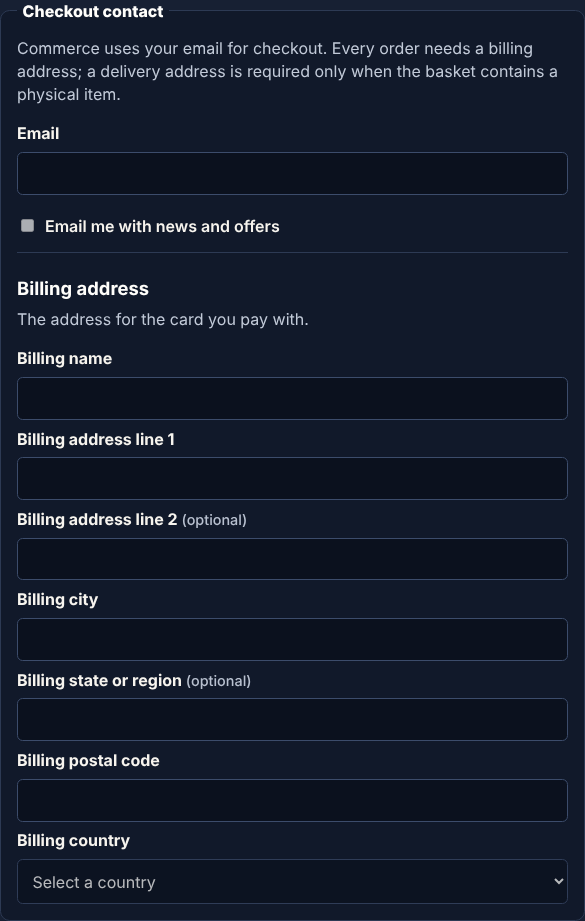
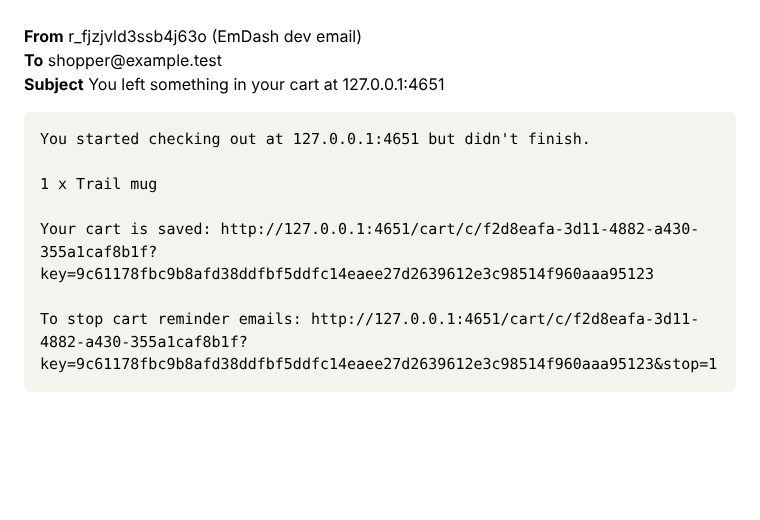
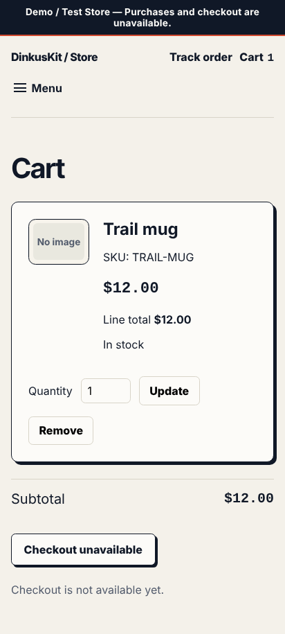
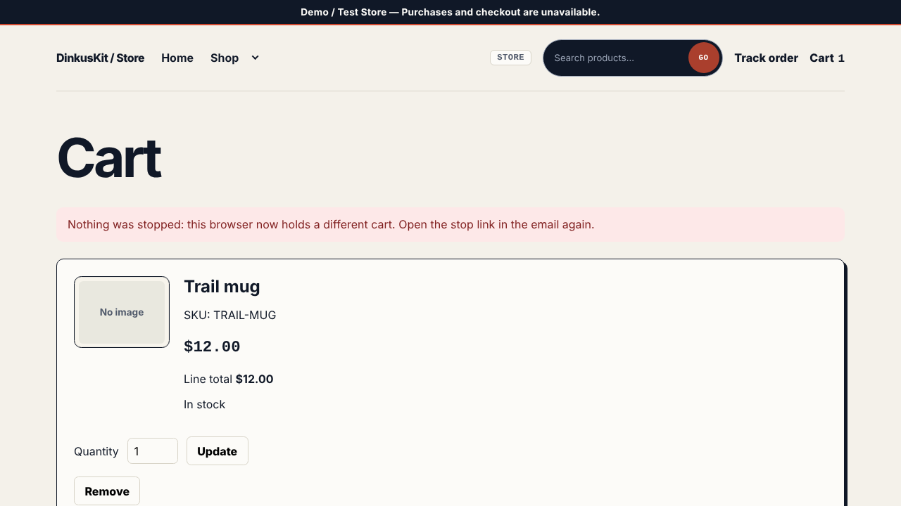
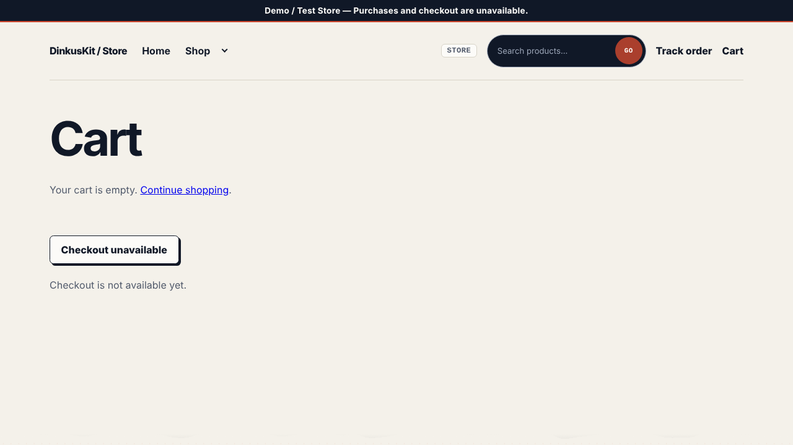
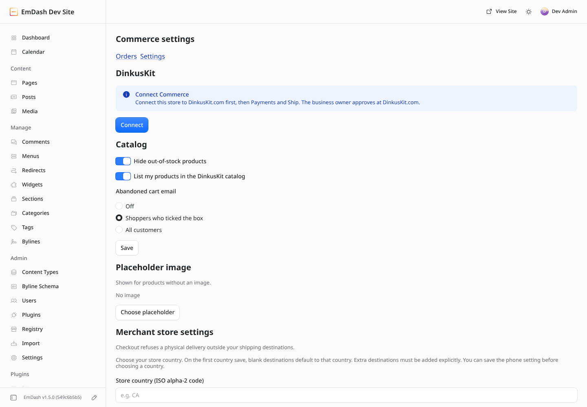

# Abandoned cart email proof (22 Nov 2026)

GrillTrack `commerce-abandoned-cart-email-20261122`. The owner approved the seven answers on 2026-11-22.

## What runs

The DinkusKit Template Store (branch `claude/project-thread-rcucsy`) ran on a fresh database with this
branch's Commerce Registry build mounted (`DINKUS_PAIRED_COMMERCE_DIR`, runtime `r_fjzjvld3ssb4j63o`),
on EmDash's Node dev server. The spec is the template's `tests/paired/abandoned-cart-email.spec.ts`;
it passed (1 test, 2.3 minutes, Chromium desktop, with phone-size views taken inside it) on template main 555a73d
merged in.

- A product made through Commerce's `catalog` route and published, added to a shopper's cart from its page.
- The proof store has no Payments, so the shopper's checkout is written as Commerce's start leaves it once
  the payment expired unpaid: one `released` attempt with the email, `news: true` and `remindAt`. The record's
  shape is the one the unit tests' real start and release produce
  (`tests/features/checkout/abandoned-cart-email.test.mjs`); `remindAt` is set a minute in the past instead
  of waiting 10 hours.
- The 5-minute check then ran for real: EmDash's scheduler started `commerce-checkout-wakes`, Commerce
  sent the email through `ctx.email` (EmDash's dev email provider caught it), and the cart record was
  marked `emailed` with `remindAt` gone.
- The email's link, opened in fresh desktop and phone browsers, made that cart theirs and showed it.
- A link with a made-up key opened `/cart` and left that browser's own cart key alone.
- The shopper then tried the same cart again with another email (`other-shopper@example.test`), which also
  ended unpaid. The stop link asked first; when a second tab had swapped this browser's cart, **Stop emails**
  stopped nothing and said so. Opened again, **Stop emails** saved exactly one `cart_email_stops` row, keyed by
  the SHA-256 of the address the email went to, not the later checkout's.
- With the cart's `cartExpires` moved into the past, the same email link opened an empty cart and the browser
  got no cart key.

| Owner's setting | Checkout tick box (starts unticked) |
| --- | --- |
|  |  |

| The email (EmDash dev email) | The link on a phone |
| --- | --- |
|  |  |

| Stop link asks | After **Stop emails** |
| --- | --- |
|  |  |

| Stop after another link swapped the cart | The link after the cart's 30 days |
| --- | --- |
|  |  |

Desktop view of the link: `link-opens-cart-desktop.png`.

EmDash reads the site's name when it starts. This proof store started before it had one, so the subject
names the store's host (`127.0.0.1:4651`); a store with a site title gets "You left something in your
cart at <title>".

## Upgrade from 0.8.0

`COMMERCE_UPGRADE_FROM=v0.8.0 COMMERCE_UPGRADE_SPEC=registry-upgrade-cart-email.spec.mjs npm run test:registry-upgrade`
passed all three phases (`registry_upgrade=pass from=v0.8.0 phases=old,bridge,new`). Commerce 0.8.0 kept a
cart key, that cart's expired-unpaid checkout and the catalog setting with Hide out-of-stock on, in 0.8.0's
shapes. This build, first on 0.8.0's EmDash and then on EmDash 1.5:

- left all three rows byte for byte as 0.8.0 stored them;
- answered the 0.8.0 key with its cart (`released-retry`, no saved lines, as 0.8.0 kept none);
- refused a stop from that key (`CHECKOUT_NOT_FOUND`: it was never in an email) and a made-up key
  (`CAPABILITY_DENIED`), with no stop row written;
- on EmDash 1.5, showed the new setting at its default beside the kept toggle, created the `remindAt` index,
  and ran the real 5-minute check with no email sent and the cart row unchanged.

Traces: `upgrade-trace-bridge.json`, `upgrade-trace-new.json`. Settings after the upgrade: `upgrade-settings.png`.

## Checks

- `npm test`: 904 pass, 0 fail (7 new in `tests/features/checkout/abandoned-cart-email.test.mjs`:
  one email after 10 hours whose link opens the same cart; at most one per cart even after a second unpaid
  checkout; the stop link stops later carts for that email in any letter case and needs the link's key; the
  three settings; paid, emptied and still-open checkouts get none and an open one is looked at an hour on;
  the tick must be `true`; a cart change keeps the reminder and drops the item list; the email's key is refused
  once its cart's 30 days pass while the shopper's own key still answers, cannot bring back a deleted cart, and
  its stop stops the address it was sent to after a retry with another email, while the shopper's own key stops
  nothing).
- `node --test tests/integration/*.test.mjs`: 111 pass.
- `bin/verify-commerce checks`: passed.
- Registry backend: 127,754 bytes on base `f8a0c0b` (was 125,973), 3,318 bytes left under 131,072.

## Not proved here

- A real Stripe checkout reaching `released` (covered by the existing checkout tests; this change only adds
  fields to the start's write).
- Delivery through a real email provider; the store needs one set up in EmDash.
