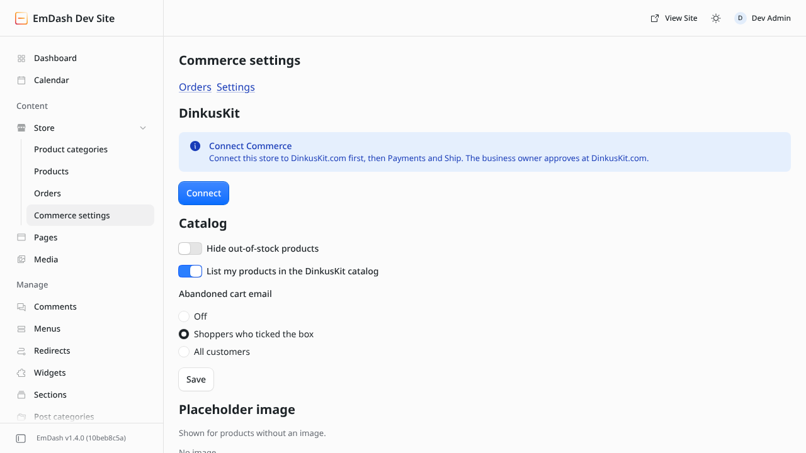
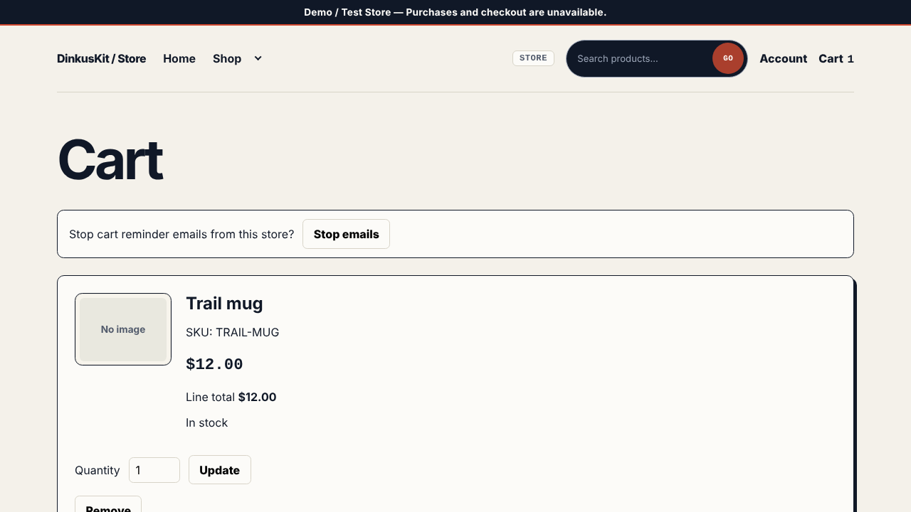
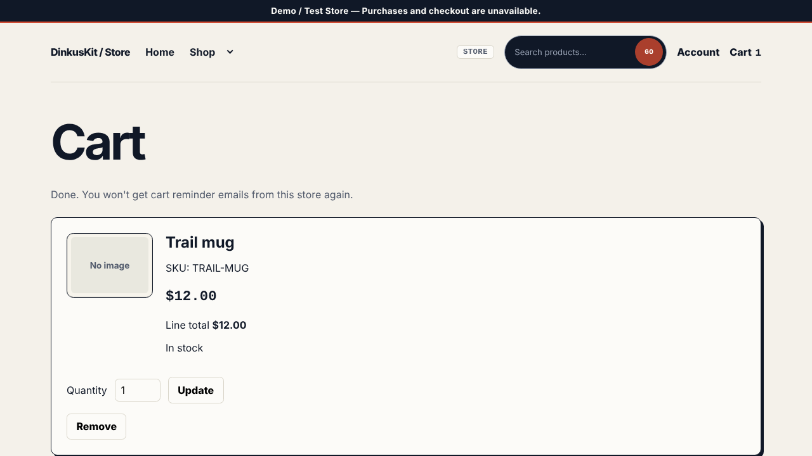

# Abandoned cart email proof (22 Nov 2026)

GrillTrack `commerce-abandoned-cart-email-20261122`. The owner approved the seven answers on 2026-11-22.

## What runs

The DinkusKit Template Store (branch `claude/project-thread-rcucsy`) ran on a fresh database with this
branch's Commerce Registry build mounted (`DINKUS_PAIRED_COMMERCE_DIR`, runtime `r_fjzjvld3ssb4j63o`),
on EmDash's Node dev server. The spec is the template's `tests/paired/abandoned-cart-email.spec.ts`;
it passed (1 test, 2.3 minutes, Chromium desktop, with phone-size views taken inside it).

- A product made through Commerce's `catalog` route and published, added to a shopper's cart from its page.
- The proof store has no Payments, so the shopper's checkout is written as Commerce's start leaves it once
  the payment expired unpaid: one `released` attempt with the email, `news: true` and `remindAt`. The record's
  shape is the one the unit tests' real start and release produce
  (`tests/features/checkout/abandoned-cart-email.test.mjs`); `remindAt` is set a minute in the past instead
  of waiting 10 hours.
- The 5-minute check then ran for real: EmDash's scheduler started `commerce-checkout-wakes`, Commerce
  sent the email through `ctx.email` (EmDash's dev email provider caught it), and the cart record was
  marked `emailed` with `remindAt` gone.
- The email's link, opened in fresh desktop and phone browsers, made that cart theirs and showed it.
- The stop link asked first; **Stop emails** saved one `cart_email_stops` row keyed by the email's SHA-256.

| Owner's setting | Checkout tick box (starts unticked) |
| --- | --- |
|  |  |

| The email (EmDash dev email) | The link on a phone |
| --- | --- |
|  |  |

| Stop link asks | After **Stop emails** |
| --- | --- |
|  |  |

Desktop view of the link: `link-opens-cart-desktop.png`.

EmDash reads the site's name when it starts. This proof store started before it had one, so the subject
names the store's host (`127.0.0.1:4651`); a store with a site title gets "You left something in your
cart at <title>".

## Checks

- `npm test`: 906 pass, 0 fail (6 new in `tests/features/checkout/abandoned-cart-email.test.mjs`:
  one email after 10 hours whose link opens the same cart; at most one per cart even after a second unpaid
  checkout; the stop link stops later carts for that email in any letter case and needs the link's key; the
  three settings; paid, emptied and still-open checkouts get none and an open one is looked at an hour on;
  the tick must be `true`; a cart change keeps the reminder and drops the item list).
- `node --test tests/integration/*.test.mjs`: 111 pass.
- `bin/verify-commerce checks`: passed.
- Registry backend: 126,645 bytes on base `d8d654c` (was 124,997), 4,427 bytes left under 131,072.

## Not proved here

- A real Stripe checkout reaching `released` (covered by the existing checkout tests; this change only adds
  fields to the start's write).
- Delivery through a real email provider; the store needs one set up in EmDash.
