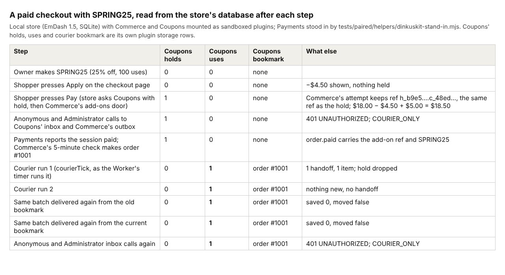

# The add-ons door (commerce-addons-door-20261124)

Run on 24 Nov 2026 with Node 24.22.0 from this branch.

- `npm run build`: `registry_bundle=pass backend_bytes=131057 headroom_bytes=15` (main before this change: 131,045 bytes, 27 free). Commerce's coupon code is gone, so the door fits. The add-on size bound below costs 58 bytes, checking each line's quantity 3 more; the public catalog's sale flag fits by shorter code behind two test-payment refusals, whose messages are unchanged.
- Unit suite (`node --test` over every `test:unit` glob): 854 tests, 854 pass.
- Integration suite (`node --test tests/integration/*.test.mjs`): 112 tests, 112 pass, including the three add-ons door cases in `registry-checkout-services.test.mjs`, which run the compiled Registry backend in workerd.
- `tests/features/orders/courier-outbox-runtime.test.mjs` (EmDash's own route dispatch): 4 pass, including `STORE_ONLY` for a signed-in Administrator and `order.paid` carrying the discount and the add-ons.

`orders-discount-line.png`: the Orders page renderer (`tools/orders-preview`) showing a synthetic order priced by the Coupons plugin. The discount line names the code the shopper used: "Discount SYNTHETIC5 −$5.00".

## An answer worked out for another quantity

Each answer line now carries the quantity the add-on saw (`qty`), beside the item and unit price. The door reads the saved cart when checkout starts, so a shopper who changes a quantity in another tab after the store asked the add-on gets `CONTENTION` and the store asks again: an amount off worked out for two hats never lands on one. `registry-checkout-services.test.mjs` shows the compiled door answering `CONTENTION` for an answer naming 2 hats on a 1-hat cart, and `checkout-pricing.test.mjs` the same for the pricing step.

On a local store with Coupons (dinkuskit/coupons#31) and the template (dinkuskit/template-store#271) sending `qty`, a shopper applied SPRING25 to one $18 mug (`qty-1-applied.jpg`), changed it to 2 in another tab, and pressed Pay on the stale page. The store asked Coupons again, and this door priced 2 × $18.00 − $9.00 + $5.00 = $32.00 (`qty-2-sent-to-stripe.jpg`, [qty-trace.txt](qty-trace.txt)).

## The left-cart email's key, after its cart ends

On a fresh local store with this branch, Coupons from dinkuskit/coupons#31 and template-store#271, and Payments stood in ([emailed-trace.txt](emailed-trace.txt)), using Commerce's own lifecycle throughout:

1. A shopper gave an email and pressed Pay, then left the Stripe page unpaid. The stand-in reported the session expired, and Commerce's own 5-minute check released the attempt.
2. With the cart's `remindAt` moved into the past (standing in for the 10 hours), the same check made the left-cart email's link, `/cart/c/<cart>?key=<emailed key>`.
3. A fresh browser opened that link, and SPRING25 applied with the emailed key (−$4.50, `emailed-1-applied.jpg`).
4. With the cart's `cartExpires` moved into the past (standing in for the 30 days), the same check deleted the cart. Commerce still held the emailed key's record.
5. That browser, its page still showing SPRING25, then posted Pay with SPRING25, Pay with no code (which would release holds) and Apply, and pressed Pay on the page. Each answered 422 with an empty cart and no box taking codes (`emailed-2-after-expiry.jpg`). Carts, attempts on that cart, Coupons holds and Payments calls were 0, 0, 0 and 5 before, and the same after.
6. Add to cart from the same browser made no cart under the emailed cart's id: the store started a new cart under a new key (`emailed-3-readd.jpg`).

The emailed key passes through `fenceEmailedKey` on the add-ons door as on the public start (`startGuestCheckout`), so it dies with its cart, its checkout or a cart made again under its id.

## The add-ons' size and the courier's 8 KB

The courier refuses a whole batch when one item is over 8 KB, and the receiver's bookmark then never moves (`src/features/orders/courier.ts`, from cb6c51e). `fit()` can only drop item lines, so the door now bounds what it keeps of the add-ons:

- Each add-on's `from`, `ref`, codes and line items are printable ASCII only, so a character is a byte.
- The `from`, `ref` and codes of all answers together are at most 1,500 characters, counted as Commerce writes them in JSON (`[[from, ref, codes], …]`, punctuation included).

`tests/features/orders/courier-outbox-runtime.test.mjs` puts the most the door accepts (4 add-ons, 1,500 characters) beside the longest address Commerce takes, with every address field 200 three-byte characters and a 200-character three-byte line name. The `order.paid` item is 6,491 bytes, with every ref and code kept and the line still in it. `registry-checkout-services.test.mjs` shows the compiled door refusing a non-ASCII ref, a code with a space, and four answers over 1,500 characters. The base commit checked only lengths, so it had neither check.

## Private routes through EmDash's own HTTP dispatch

Run on 24 Nov 2026 on a local template store (`scripts/dev-fresh.sh` with `DINKUS_PAIRED_COMMERCE_DIR` = this branch and `DINKUS_PAIRED_COUPONS_DIR` = dinkuskit/coupons#31). Commerce runs under its beta Registry id `r_fjzjvld3ssb4j63o`. The shopper added a mug, so they hold a real `dk_cart` cart key cookie. Responses are as returned:

| Caller | `POST /_emdash/api/plugins/r_fjzjvld3ssb4j63o/checkout/addons/start` with a contact and a 100%-off add-on answer |
| --- | --- |
| Anonymous, with the shopper's cart key cookie | `401 UNAUTHORIZED: Authentication required` |
| Signed-in Administrator | `400 ROUTE_ERROR … STORE_ONLY: Only the store's own code may use this door.` |

After both calls, the shopper's `/checkout` still shows the discount box, which only shows while no payment is held, so no checkout attempt was started. The store's own server code then priced the cart: Apply SPRING25 on `/checkout` showed "SPRING25 −$4.50" and the Discount row. The paid start through the door is below.

## A paid checkout through the door, from the store's own code

Run on 24 Nov 2026 on fresh local template stores like the one above (this branch at 2d8927e, Coupons from dinkuskit/coupons#31, template-store#271), with Payments stood in by template-store's `tests/paired/helpers/dinkuskit-stand-in.mjs` (plus a "paid" answer in the proof's copy). Everything else is the real code. Rows were read from the store's database after each step. The logs are [paid-trace.txt](paid-trace.txt) and [edge-trace.txt](edge-trace.txt).

1. **The allowed call.** The shopper applied SPRING25 to the $18 mug and pressed Pay on `/checkout`. The store's server code asked Coupons with `hold: true`, then called `checkout/addons/start`.
   - The new checkout attempt keeps `addons: [{ from: "dinkus-coupons", ref: "h_b9e5….c_48ed…", codes: ["SPRING25"] }]`.
   - Its payment request, which went to Payments' `POST /v1/checkout/session`, is priced at subtotal 1800, coupon discount 450, shipping 500 and total 1850. The shopper was sent to the session's Stripe address (`paid-sent-to-stripe.jpg`).
2. **Forbidden callers before payment.** An anonymous caller and the Administrator called `courier/outbox` and Coupons' `courier/inbox`. They got `401` and `COURIER_ONLY`, and nothing changed.
3. **Paid.** Payments' lookup answered paid. Commerce's own 5-minute check made order #1001: total 1850, the same `addons`, and an `order.paid` news key.
4. **Courier.** The store's courier read that news through `courier/outbox` and handed it to Coupons, which counted one use. Repeats counted nothing.
5. **A cart key Commerce refuses.** The shopper's own cart id, with a wrong secret, posted their checkout form with SPRING25. The store answered 422 with an empty cart (`forged-key.jpg`). Checkout attempts, Coupons holds and Payments calls were 0, 0 and 0 before and after. The real shopper's Pay right after still worked.
6. **A payment-free order.** FREE100 (100% off) and FREESHIP on the $18 mug with $5 shipping went through the door to an attempt paid at $0.00. Payments received no call (2 calls before, 2 after), and the shopper reached the order confirmation (`zero-order.jpg`).

Not proven here: a real Stripe payment. A beta store run is the next check.

## Stored data after the upgrade

`COMMERCE_UPGRADE_FROM=v0.8.0 COMMERCE_UPGRADE_SPEC=registry-upgrade-cart-email.spec.mjs node scripts/registry-upgrade-proof.mjs` (Playwright pointed at the container's installed Chromium). Commerce 0.8.0 writes a shopper's cart key, that cart's unpaid checkout, a paid order and a saved catalog setting in its own shapes. Then this build runs, first on 0.8.0's EmDash and then on this checkout's EmDash, against the same database. All 3 phases passed. Every row stays as it was, the old cart key still answers, and no old order or cart becomes courier news.

Rows written before this change have no `addons`. A checkout attempt without them compares as `[]` when its cart is frozen, and an order without them sends `addons: []` in its paid news (`courier-outbox-runtime.test.mjs`, order-5). Commerce's Registry build never stored a coupon on an attempt or order, so nothing it wrote names the removed coupon fields.

## The sale flag, used by a coupon that skips sale items

The public catalog flags a Sale price with `onSale: true` (`commerce-sale-flag-20261124`). On a fresh local store with this branch's Registry build, Coupons from dinkuskit/coupons#31 and template-store#271 ([sale-trace.txt](sale-trace.txt)), `catalog/public` flagged the demo cap ($24.00, a Sale price) and not the mug ($18.00). NOSALE20, 20% off with "Don't discount items already on sale" ticked, took −$3.60 from a cart holding both, which is 20% of the mug alone (`sale-1-mixed-applied.jpg`). Pay went through the add-ons door, and the attempt Commerce saved gave the cap 0 off and the mug 360 cents off: subtotal 4200, discount 360, shipping 500, total 4340. With only the cap in the cart, the code was refused: "This code doesn't apply to anything in your cart." (`sale-3-only-sale-item.jpg`).
