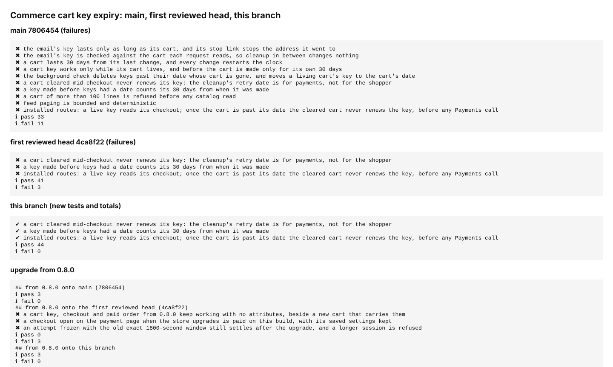

# Cart key expiry, cart line cap and feed text (deepsec G5-13, G5-05, G5-06, G5-07, G1-11, G1-12)

The owner approved this scope on 2026-11-25. GrillTrack `commerce-cart-key-expiry-20261125`.

The same four test files run against three sources: `main` (7806454), the first reviewed head (4ca8f22) and
this branch. The files are `tests/features/checkout/server-cart.test.mjs`, `tests/features/checkout/cart-left-news.test.mjs`,
`tests/features/feeds/product-feeds.test.mjs` and `tests/integration/cart-key-expiry-installed.test.mjs`.

| Source | Result | File |
| --- | --- | --- |
| main 7806454 | 33 pass, 11 fail | [main.txt](main.txt) |
| first reviewed head 4ca8f22 | 41 pass, 3 fail | [first-review.txt](first-review.txt) |
| this branch | 44 pass, 0 fail | [branch.txt](branch.txt) |

[upgrade-from-0.8.0.txt](upgrade-from-0.8.0.txt) runs the repository's upgrade tests: Commerce 0.8.0's own compiled
runtime makes a key and a checkout, then the build under test opens the same database. They pass on main, fail on
the first reviewed head (the old key, which has no `expiresAt`, was refused) and pass on this branch.

## What the tests show

- **Installed routes, end to end** (`cart-key-expiry-installed.test.mjs`): the compiled Registry backend runs in
  workerd with EmDash's real storage bridge, and the routes are called as the store's pages call them. A live key
  reads its checkout. Once the cart and key are past their date with a payment still unfinished, the 5-minute
  background check clears the cart's lines, keeps the attempt with a retry date a day on, and deletes the key. A
  copy of the key the check has not reached is refused by both the cart read and start (`CAPABILITY_DENIED`) with
  0 calls to Payments.
- **A cleared cart never renews its key.** The retry date on a cleared cart is for reconciling its payment. The
  key check and the key sweep read the cart's date only while the cart has lines; otherwise the key's own date
  applies. On the first reviewed head the sweep copied the retry date onto the key and the key worked again.
- **Keys made before this change** have no `expiresAt`, so they count 30 days from `createdAt`.
- **A key lives as long as its cart.** Before a cart is made, a key works for 30 days from `prepare` and is refused
  after. A cart made on day 20 carries its key to day 50. Past the cart's 30 days, the shopper's own key and the
  email's key are both refused; on main the shopper's key kept working forever.
- **The background check deletes keys.** Keys past their date whose cart is gone are deleted. A key whose cart
  still lives moves to the cart's date and is not picked up again until then. On main, nothing ever deleted a key.
- **A cart of 101 lines is refused before any catalog read** (0 reads). On main every line was looked up first.
- **Feeds:** a page size that is not a whole number throws instead of returning the same cursor. NUL, vertical tab,
  unit separator, U+FFFF and a lone surrogate are dropped from both feeds, a real emoji is kept, and the next
  product is still in the Google feed.

The storefront already treats a refused key as no cart and asks `prepare` for a new one
(`template-store` `src/features/guest-cart/server-cart.ts`), so a shopper whose cart expired sees an empty cart.

Keys from before this change are not swept, as on main: the sweep finds keys by `expiresAt`. They are refused
30 days after they were made, and only the 0.8.0 release and the 0.9.0 betas made them.
